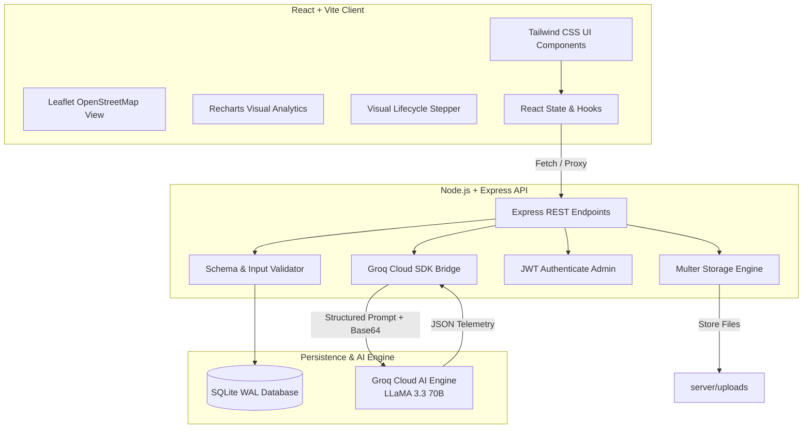

# CivicResolve – Technical Architecture & System Design

## 1. System Overview

CivicResolve is built as a modular full-stack web application designed for high responsiveness, verifiable data persistence, and real-time AI triage integration.

---

## 2. Database Schema (SQLite 3 via `better-sqlite3`)

The database uses Write-Ahead Logging (`PRAGMA journal_mode = WAL`) to ensure lock-free concurrent reads and reliable transactional writes.

### Entity: `complaints`

| Column | Type | Constraints | Description |
| :--- | :--- | :--- | :--- |
| `id` | `INTEGER` | PRIMARY KEY AUTOINCREMENT | Unique numeric complaint identifier. |
| `ref_id` | `TEXT` | UNIQUE NOT NULL | Human-readable tracking ID (`CR-YYYY-XXXX`). |
| `title` | `TEXT` | NOT NULL | Headline of the reported issue. |
| `description` | `TEXT` | NOT NULL | Detailed citizen problem description. |
| `category` | `TEXT` | NOT NULL | Municipal classification category. |
| `location` | `TEXT` | NOT NULL | Street name, landmark, or intersection. |
| `latitude` | `REAL` | NULLABLE | Geographic latitude coordinate. |
| `longitude` | `REAL` | NULLABLE | Geographic longitude coordinate. |
| `image_url` | `TEXT` | NULLABLE | Static relative URL path to uploaded photo evidence. |
| `status` | `TEXT` | DEFAULT 'Submitted' | Lifecycle state: `Submitted`, `Under Review`, `Assigned`, `In Progress`, `Resolved`. |
| `priority` | `TEXT` | DEFAULT 'Medium' | Severity urgency: `Low`, `Medium`, `High`, `Critical`. |
| `department` | `TEXT` | NULLABLE | Responsible civic department. |
| `ai_summary` | `TEXT` | NULLABLE | Concise technical synthesis generated by AI. |
| `ai_category` | `TEXT` | NULLABLE | AI-predicted grievance category. |
| `ai_priority` | `TEXT` | NULLABLE | AI-predicted severity rating. |
| `ai_department` | `TEXT` | NULLABLE | AI-recommended municipal division. |
| `ai_confidence` | `REAL` | NULLABLE | AI model confidence score (0.00 – 1.00). |
| `ai_reason` | `TEXT` | NULLABLE | Reasoning behind classification. |
| `ai_safety_risk` | `TEXT` | NULLABLE | Assessment of public safety threats. |
| `ai_recommended_action` | `TEXT` | NULLABLE | Concrete field action suggested by AI. |
| `ai_suggested_response_time` | `TEXT` | NULLABLE | Recommended SLA (e.g. '4 hours', '24 hours'). |
| `ai_status` | `TEXT` | DEFAULT 'UNAVAILABLE' | Status of AI processing: `SUCCESS` or `UNAVAILABLE`. |
| `resolution_remarks` | `TEXT` | NULLABLE | Official closing notes recorded by administrator. |
| `status_history` | `TEXT` | JSON ARRAY | Chronological audit trail of all status transitions. |
| `is_gps_verified` | `INTEGER` | DEFAULT 0 | 1 if GPS device coordinates were validated, 0 for street addresses. |
| `created_at` | `DATETIME` | DEFAULT CURRENT_TIMESTAMP | Submission timestamp. |
| `updated_at` | `DATETIME` | DEFAULT CURRENT_TIMESTAMP | Last modification timestamp. |

### Entity: `admins`

| Column | Type | Constraints | Description |
| :--- | :--- | :--- | :--- |
| `id` | `INTEGER` | PRIMARY KEY AUTOINCREMENT | Unique admin identifier. |
| `email` | `TEXT` | UNIQUE NOT NULL | Administrator login email. |
| `password_hash` | `TEXT` | NOT NULL | bcrypt hash (cost factor 12). |
| `name` | `TEXT` | NOT NULL | Official name of administrator. |
| `role` | `TEXT` | DEFAULT 'admin' | Role permission level. |
| `created_at` | `DATETIME` | DEFAULT CURRENT_TIMESTAMP | Creation timestamp. |
| `updated_at` | `DATETIME` | DEFAULT CURRENT_TIMESTAMP | Last updated timestamp. |

---

## 3. AI Triage Pipeline (Groq Cloud)

1. Citizen submits form with title, description, category, and optional photo.
2. `server/groq-ai.js` connects to Groq Cloud via official `groq-sdk`.
3. System prompt enforces strict structured JSON mode (`response_format: { type: 'json_object' }`).
4. Selected model (defaults to `llama-3.3-70b-versatile` with automatic candidate fallback) parses and triages in sub-second time.
5. If an image is provided:
   - For vision models (`llama-3.2-90b-vision-preview`), base64 inline image is attached.
   - For text models, an honest text analysis executes and the photo is preserved for manual review.
6. If API or network is unavailable, the **Honest Fallback Protocol** queues the grievance for human officer review without fabricating synthetic responses.
